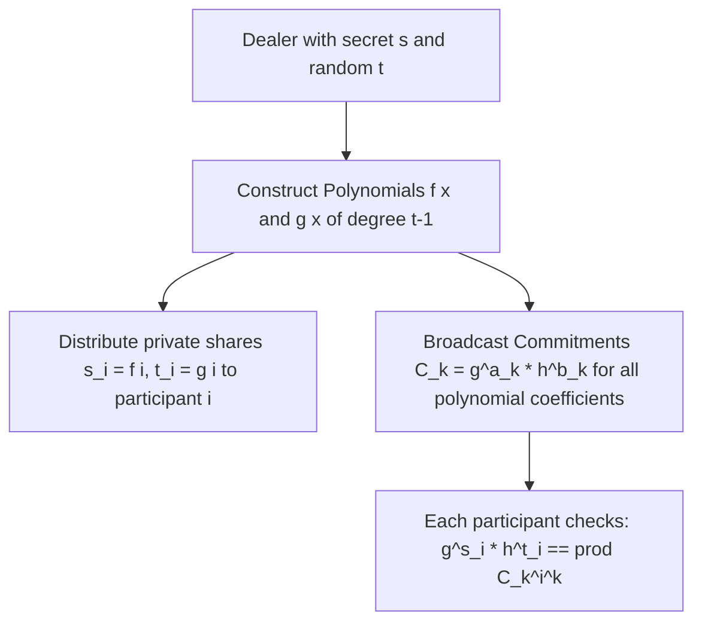

# Pedersen Verifiable Secret Sharing (VSS)

Verifiable Secret Sharing extends Shamir's $(t, n)$ secret sharing by enabling participants to verify that their received shares are consistent without revealing the secret itself, providing unconditional privacy even against a malicious dealer.

---

## 1. Feldman VSS vs Pedersen VSS

| Dimension | Feldman VSS | Pedersen VSS |
|---|---|---|
| **Commitment Type** | $C_k = g^{a_k}$ (Homomorphic Exponentiation). | $C_k = g^{a_k} \cdot h^{b_k}$ (Pedersen Double Generator). |
| **Secrecy** | Computational (Assumes discrete logarithm hardness). | **Information-Theoretic (Unconditional Secrecy)**. |
| **Verification** | Computational. | Computational (Binding property relies on discrete log). |
| **Trapdoor Requirement** | Standard generator $g$. | Dual generators $g, h$ with unknown $\log_g(h)$. |
| **Use Cases** | Basic threshold key generation (DKG). | High-assurance threshold crypto, MPC input phases. |

---

## 2. Verification Equation

Each participant $i$ receives share $s_i = f(i)$ and masking share $t_i = g(i)$, and verifies:

$$g^{s_i} h^{t_i} = \prod_{k=0}^{t-1} \left( C_k 
ight)^{i^k}$$

Proof of equality:
$$\prod_{k=0}^{t-1} \left( g^{a_k} h^{b_k} 
ight)^{i^k} = g^{\sum a_k i^k} h^{\sum b_k i^k} = g^{f(i)} h^{g(i)} = g^{s_i} h^{t_i}$$
