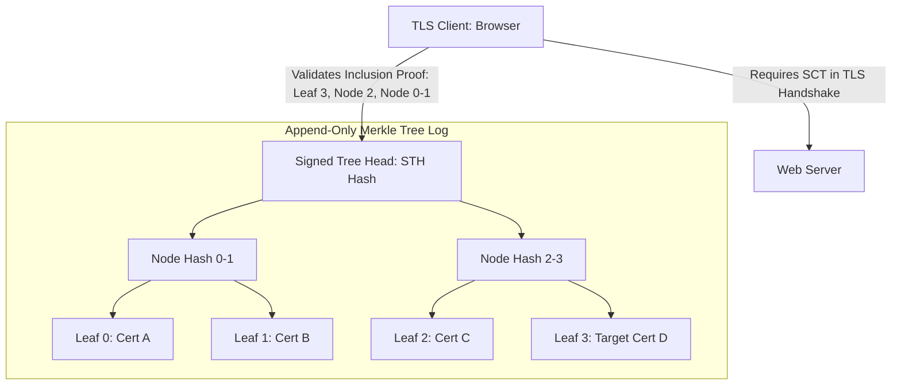

# PKI: Certificate Transparency (RFC 6962) & Merkle Audit Proofs

Certificate Transparency (CT) eliminates rogue and undetected Certificate Authority (CA) issuances through append-only, publicly auditable cryptographic Merkle Tree logs.

---

## 1. Cryptographic Proofs

1. **Signed Certificate Timestamp (SCT):** Cryptographic promise by a log operator that a certificate has been queued for inclusion in the log.
2. **Inclusion Proof (Audit Proof):** Log returns an $O(\log N)$ sequence of sibling hashes proving a specific leaf exists in the tree root.
3. **Consistency Proof:** Proves that an updated tree of size $M$ extends an earlier validated tree of size $N$ without rewriting, reordering, or deleting prior leaves.
