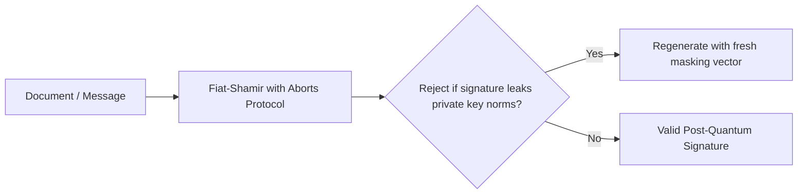

# Post-Quantum Security: NIST ML-DSA (CRYSTALS-Dilithium) Signatures

NIST ML-DSA provides post-quantum digital signature verification based on the hardness of the Module Learning With Errors (M-LWE) and Module Short Integer Solution (M-SIS) problems.

---

## 1. Rejection Sampling Invariant
Signatures are sampled from a distribution that is statistically independent of the secret key, preventing differential power and lattice leakage attacks.
