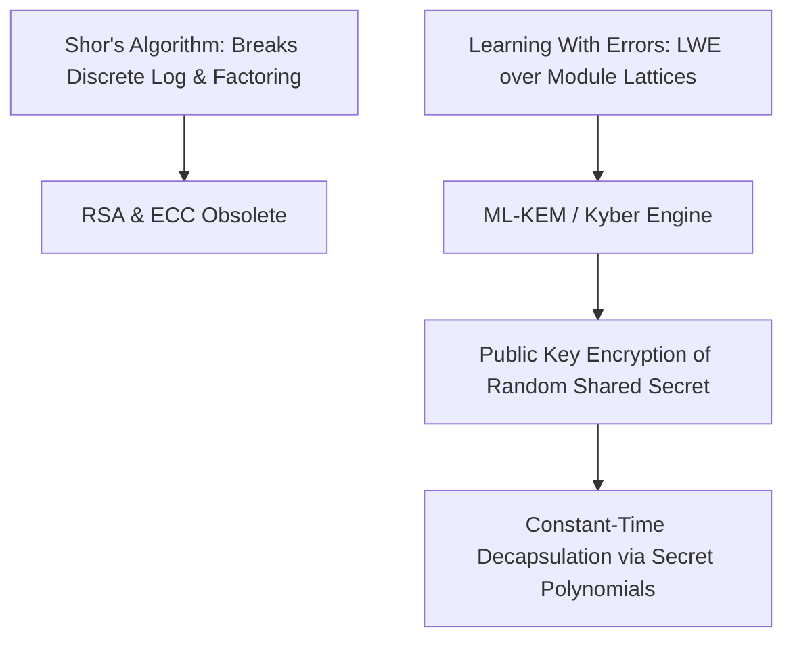

# Post-Quantum Security: NIST ML-KEM (CRYSTALS-Kyber) Architecture

NIST selected ML-KEM (Module-Lattice Key Encapsulation Mechanism) as the post-quantum standard to replace RSA and ECDH against Shor's algorithm on quantum computers.

---

## 1. Mathematical Hardness
Hardness reduces to finding shortest vectors in high-dimensional module lattices (Module Learning With Errors - M-LWE), known to be exponential for both classical and quantum computing.
