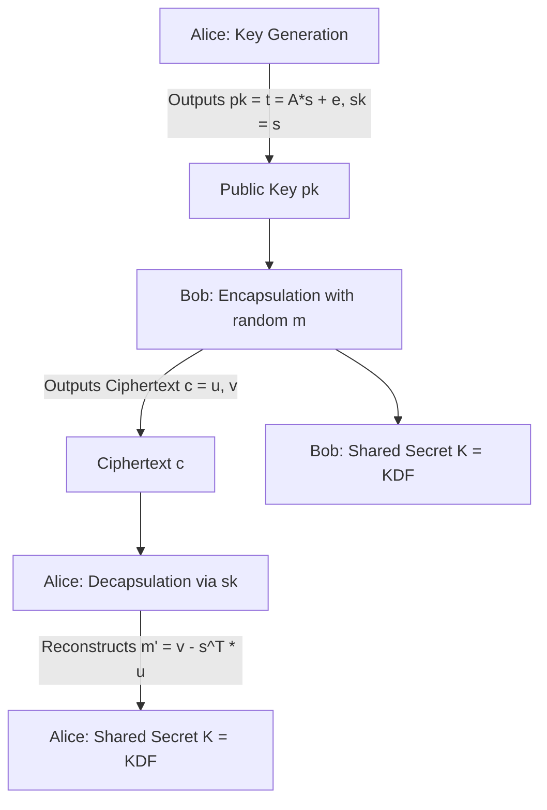

# NIST FIPS 203 ML-KEM (Kyber) Lattice Key Encapsulation

ML-KEM is the standardized post-quantum Key Encapsulation Mechanism based on the Module Learning With Errors (M-LWE) problem over polynomial quotient rings.

---

## 1. Parameter Sets (FIPS 203)

| Standard Name | Security Category | Module Rank ($k$) | Public Key Size | Ciphertext Size | NIST Equivalent |
|---|---|---|---|---|---|
| **ML-KEM-512** | Level 1 | 2 | 800 bytes | 768 bytes | AES-128 / SHA-256 |
| **ML-KEM-768** | Level 3 | 3 | 1184 bytes | 1088 bytes | AES-192 / SHA-384 |
| **ML-KEM-1024** | Level 5 | 4 | 1568 bytes | 1568 bytes | AES-256 / SHA-512 |

---

## 2. Ring Arithmetic Foundations

* Polynomial ring: $\mathcal{R}_q = \mathbb{Z}_q[X] / (X^{256} + 1)$
* Modulus: $q = 3329$ (prime with $q \equiv 1 \pmod{2n}$, enabling Number Theoretic Transform / NTT).
* NTT butterfly operations enable $O(n \log n)$ polynomial multiplication over 256 coefficients.
* Centered binomial distribution $eta_\eta$ samples error polynomials $e$ and secrets $s$.
