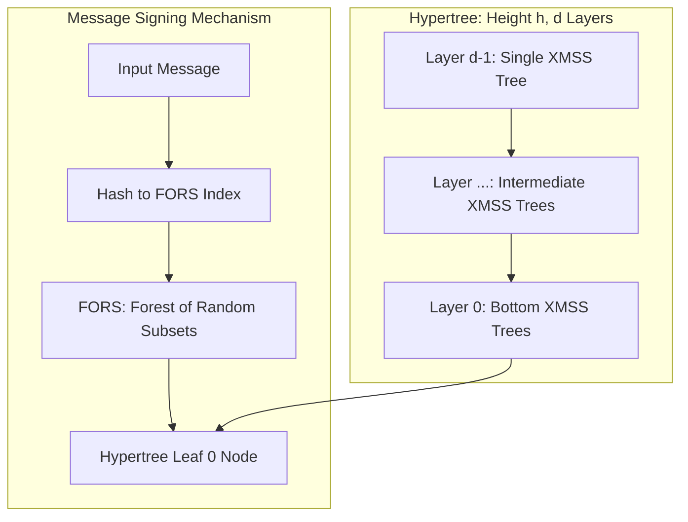

# Post-Quantum Cryptography: SLH-DSA (SPHINCS+) Architecture

SLH-DSA (FIPS 205, formerly SPHINCS+) is a stateless hash-based digital signature algorithm whose cryptographic security relies exclusively on the collision and pre-image resistance of cryptographic hash functions (SHA-2, SHAKE).

---

## 1. Architectural Components

1. **WOTS+ (Winternitz One-Time Signatures):** Signs message chunks using hash chains. Each key pair signs strictly one message.
2. **XMSS Trees:** Merkle trees that aggregate multiple WOTS+ public keys into a single verification root.
3. **Hypertree Structure:** Stacks XMSS trees across $d$ layers, enabling signing capacity ($2^h$ signatures) without traversing giant monolithic Merkle trees.
4. **FORS (Forest of Random Subsets):** Few-time signature scheme used to sign the hashed message digest directly at the base of the hypertree.
