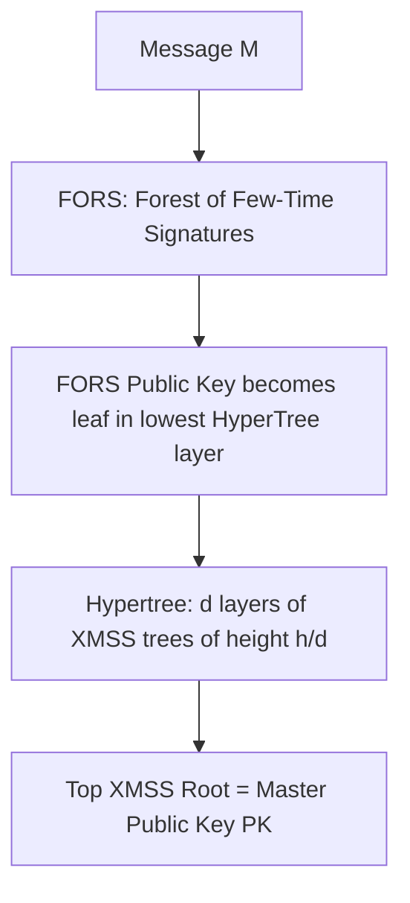

# NIST FIPS 205 SLH-DSA (SPHINCS+) Stateless Hash Signatures

SLH-DSA is a stateless hash-based post-quantum digital signature standard whose security relies solely on the collision and preimage resistance of underlying cryptographic hash functions.

---

## 1. Architectural Layers

1. **WOTS+ (Winternitz One-Time Signatures):** Signs single messages efficiently by exposing hash iteration chain ends.
2. **FORS (Forest of Random Subsets):** Few-time signature scheme signing message digests.
3. **Hypertree:** Tiered hierarchy of Merkle trees amortizing total tree height $h$ (typically $h=64$) across $d$ layers of height $h/d$.
4. **Stateless Nature:** Eliminates state tracking; index derivation hashes the message and a random salt, ensuring collision probability across $2^{64}$ signatures is negligible.
