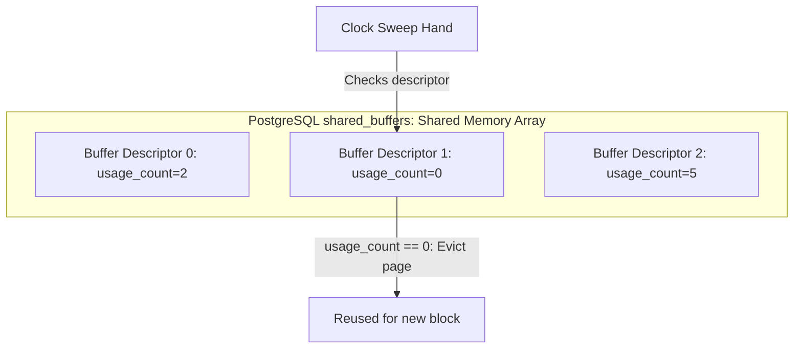

# PostgreSQL: Buffer Pool Management & Clock-Pro Eviction

PostgreSQL manages database page caching in shared memory using clock sweep algorithms to eliminate lock contention on hot pages while resisting sequential scan cache pollution.

---

## 1. Algorithm Mechanics

1. **Usage Counters:** Each buffer descriptor contains an atomic `usage_count` (0 to 5), incremented on every buffer access.
2. **Clock Sweep Hand:** When a free buffer is needed, the clock hand iterates through descriptors:
   * If `usage_count > 0`, it decrements the counter and advances.
   * If `usage_count == 0` and the buffer is unpinned and clean, it is claimed for the incoming block.
3. **Sequential Scan Protection:** Full-table scans allocate a small 256 KB ring buffer instead of displacing pages in `shared_buffers`.
