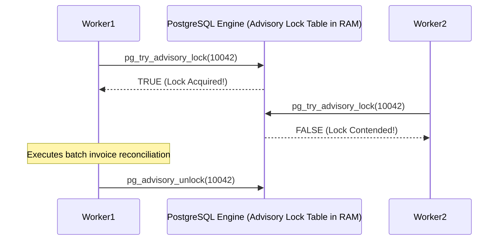

# Concurrency Control: PostgreSQL Application Advisory Locks

PostgreSQL Advisory Locks allow applications to acquire arbitrary cluster-wide mutexes without locking physical table rows or rows that do not exist yet.

---

## 1. Session vs Transaction Scope
- `pg_advisory_lock()`: Survives transaction boundaries; released explicitly or on connection disconnect.
- `pg_advisory_xact_lock()`: Automatically released upon transaction `COMMIT` or `ROLLBACK`.
