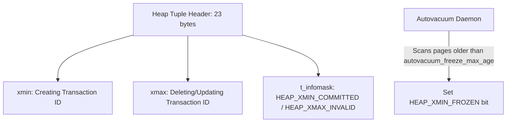

# PostgreSQL MVCC: Tuple Visibility & Vacuum Freeze Architecture

PostgreSQL stores multiple versions of modified rows directly in heap pages. Transaction IDs (`xmin`, `xmax`) determine visibility, requiring vacuum freezes to avert 32-bit transaction wraparound corruption.

---

## 1. Visibility Rules

* If `xmin` is uncommitted, tuple is invisible to other transactions.
* If `xmin` is committed and `xmax = 0` (or aborted), tuple is visible.
* If `HEAP_XMIN_FROZEN` is set, tuple is unconditionally visible to all past, present, and future transactions.
