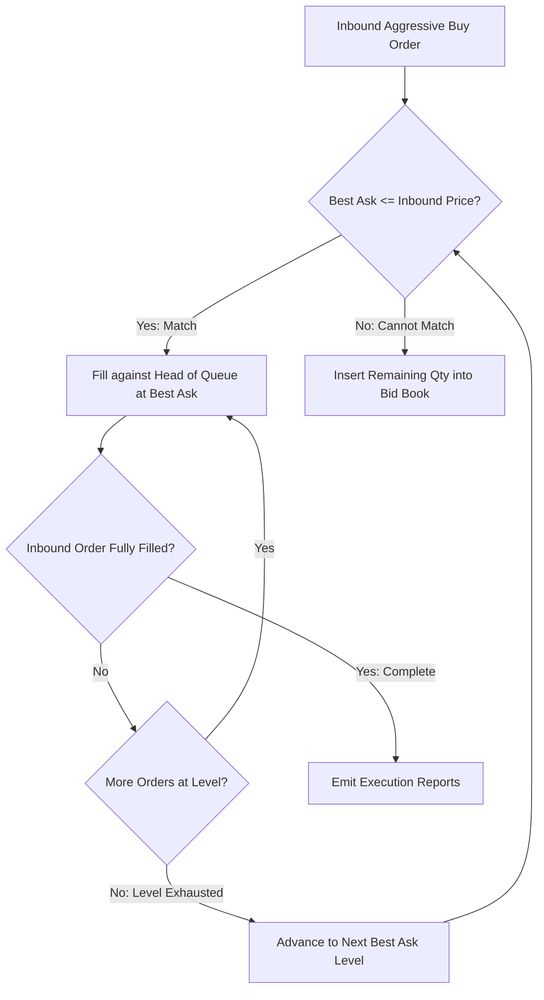

# Price-Time Priority (FIFO) Matching Algorithm

The Price-Time Priority matching engine fills orders first by best price, and within the same price level by timestamp order of arrival.



---

## 1. Matching Engine Execution Loop

```cpp
#include <algorithm>
#include <cstdint>

struct ExecutionReport {
    uint64_t maker_id;
    uint64_t taker_id;
    int64_t fill_price;
    uint32_t fill_qty;
};

void match_aggressive_buy(LimitOrder* taker_order, PriceLevel* best_ask) {
    while (taker_order->quantity > 0 && best_ask != nullptr && best_ask->price <= taker_order->price) {
        LimitOrder* maker = best_ask->head;
        if (!maker) break;

        uint32_t match_qty = std::min(taker_order->quantity, maker->quantity);
        taker_order->quantity -= match_qty;
        maker->quantity -= match_qty;
        best_ask->total_volume -= match_qty;

        emit_execution({maker->order_id, taker_order->order_id, best_ask->price, match_qty});

        if (maker->quantity == 0) {
            best_ask->remove(maker);
            free_order(maker);
        }
    }
}
```
