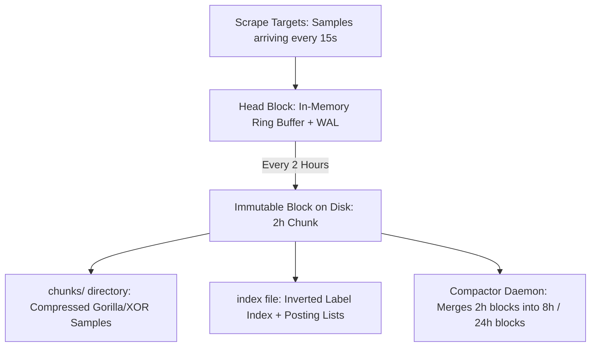

# Observability Storage: Prometheus TSDB Block Layout

Prometheus stores time-series samples in two-hour immutable blocks containing data chunks, metadata, and an inverted index.

---

## 1. Gorilla Floating-Point Compression
Prometheus utilizes Facebook's Gorilla compression algorithm:
- Timestamps compressed using delta-of-deltas (~1.37 bytes per timestamp).
- Values compressed using XOR of floating-point representations.
