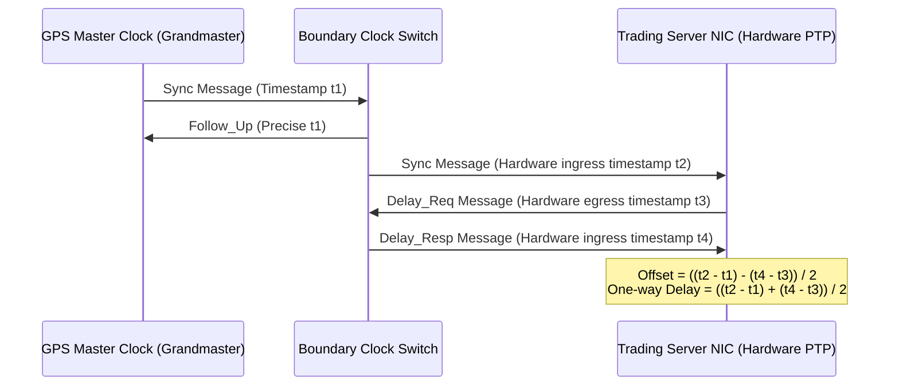

# IEEE 1588 PTP & Sub-Microsecond Network Timestamping

Precision Time Protocol (PTP IEEE 1588v2) synchronizes clocks across distributed trading infrastructure to sub-microsecond accuracy using hardware NIC timestamping.



---

## 1. PTP Hardware Timestamping vs Software NTP

| Feature | Network Time Protocol (NTP) | IEEE 1588 PTP Hardware Timestamping |
|---|---|---|
| Timestamp Generation Point | Application / Kernel socket layer | PHY / MAC silicon on NIC hardware |
| Accuracy | 1 ms – 10 ms | 10 ns – 100 ns |
| Frequency Offset Compensation | Periodic stepping / slewing | Hardware clock accumulator adjustment |
| Regulatory Compliance | Fails MiFID II RTS 25 requirements | Exceeds MiFID II 100 µs synchronization requirement |

---

## 2. Reading Hardware Timestamps via Linux Sockets

```cpp
#include <linux/net_tstamp.h>
#include <linux/sockios.h>
#include <sys/ioctl.h>
#include <sys/socket.h>

void enable_hardware_timestamps(int sock_fd, const char* if_name) {
    struct hwtstamp_config hw_cfg = {
        .flags = 0,
        .tx_type = HWTSTAMP_TX_ON,
        .rx_filter = HWTSTAMP_FILTER_ALL
    };

    struct ifreq ifr;
    strncpy(ifr.ifr_name, if_name, sizeof(ifr.ifr_name));
    ifr.ifr_data = (char*)&hw_cfg;

    // Direct hardware NIC register configuration
    ioctl(sock_fd, SIOCSHWTSTAMP, &ifr);
}
```
