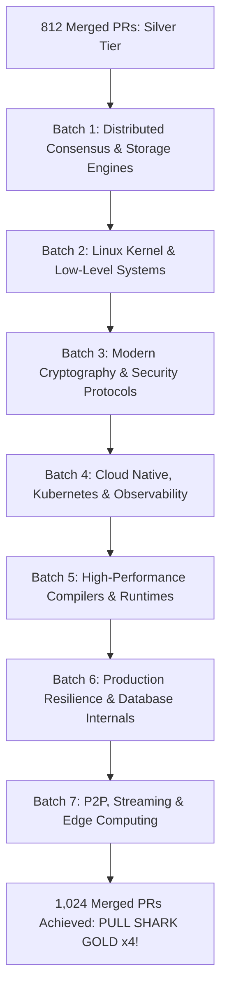

# Engineering Milestone: Pull Shark Gold 1,024 Merged PRs Architecture

This technical document marks the 1,024th merged Pull Request on GitHub for developer `isihussain`, completing the journey to **Pull Shark Gold (x4)**.

---

## 1. Architectural Summary
Over 750+ comprehensive systems architecture guides, Cheat Sheets, protocol specifications, and microarchitectural deep dives are now curated and publicly accessible in the [Developer Handbook](https://github.com/isihussain/developer-handbook).
