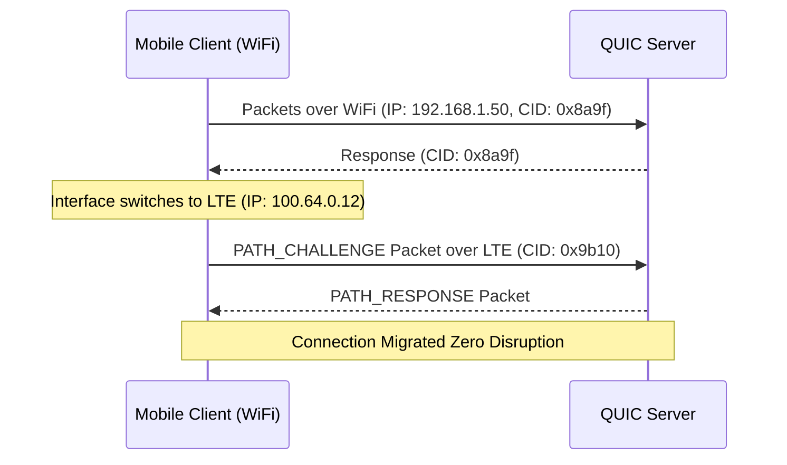

# QUIC Connection Migration & 0-RTT Handshake Architecture

QUIC replaces 4-tuple IP/Port bindings with cryptographic 64-bit Connection IDs (CIDs), allowing active TLS sessions to survive network transitions seamlessly without renegotiation.

---

## 1. 0-RTT Anti-Replay Defense

1. Client caches TLS session ticket containing cryptographic parameters from previous session.
2. Initial flight sends encrypted early data alongside `ClientHello`.
3. Server rejects replayed 0-RTT requests via strike registers or monotonically increasing transaction tokens.
