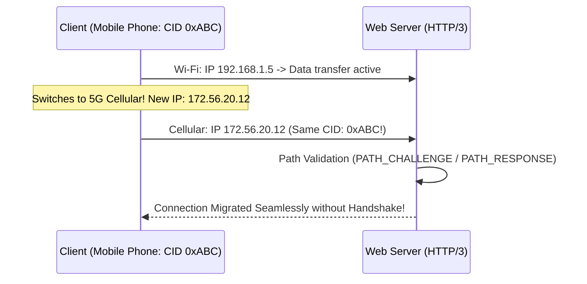

# Modern Protocols: QUIC (HTTP/3) Connection Migration Architecture

Traditional TCP connections break when a mobile device switches from Wi-Fi to cellular because the 4-tuple (`saddr, sport, daddr, dport`) changes. QUIC uses a persistent 64-bit Connection ID (CID).

---

## 1. Zero Interruption
Active video streams, WebSockets, and downloads continue uninterrupted during network handoffs.
