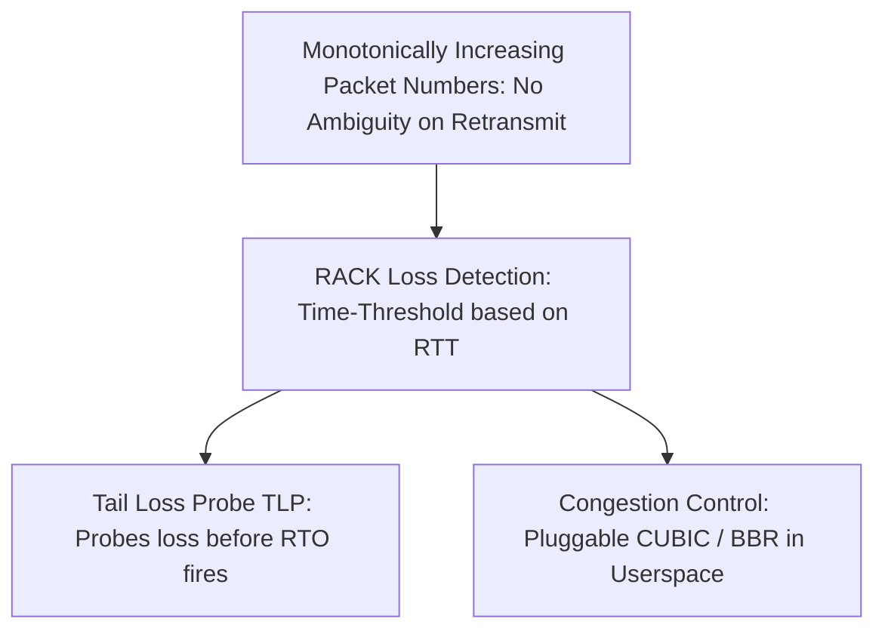

# QUIC: RFC 9002 Loss Detection & RACK-TLP Architecture

QUIC decouples transport congestion control from TCP kernel stacks, implementing monotonically increasing packet numbers and RACK-TLP time-based loss detection.

---

## 1. Protocol Innovations

1. **No Retransmission Ambiguity:** Retransmitted frames receive new packet numbers. ACKs explicitly identify which packet was received, eliminating RTT measurement ambiguity.
2. **Stream Multiplexing Without Head-of-Line Blocking:** A dropped packet in Stream 1 halts Stream 1 only; Streams 2 through $N$ continue streaming without interruption.
