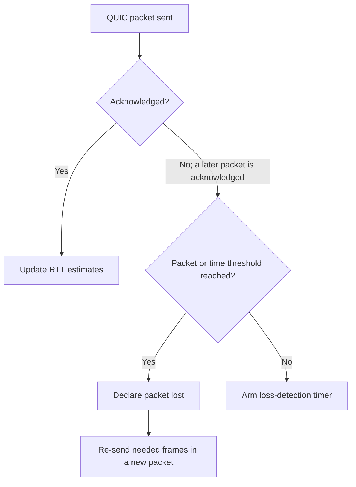

# QUIC RFC 9002 Loss Detection & Congestion Control

QUIC loss detection runs over UDP and uses packet numbers that are unique within a packet-number space. A lost STREAM frame can be sent again in a new packet; the packet number is not reused. This lets ACKs identify exactly which transmission they acknowledge.

## 1. Loss thresholds

An endpoint can declare an outstanding packet lost after a later packet in the **same packet-number space** is acknowledged and either threshold is met:

- **Packet threshold:** the acknowledged packet number is at least 3 greater than the outstanding packet's number.
- **Time threshold:** the packet has been outstanding for at least `max(9/8 × max(latest_rtt, smoothed_rtt), timer_granularity)`. The recommended timer granularity is 1 ms.

These are recommended initial values from RFC 9002, not a fixed universal timeout. Implementations may adjust the threshold to account for observed reordering. Acknowledgments of packets in one packet-number space do not trigger loss detection for another space.

## References

- IETF, [RFC 9002: QUIC Loss Detection and Congestion Control, Section 6.1](https://datatracker.ietf.org/doc/html/rfc9002#section-6.1).
