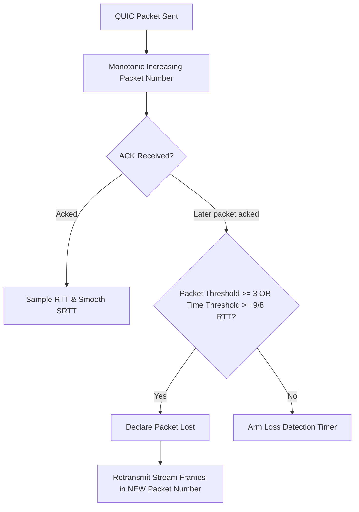

# QUIC RFC 9002 Loss Detection & Congestion Control

QUIC (RFC 9002) replaces TCP loss recovery by operating entirely over UDP with encrypted packet numbers and independent stream multiplexing.

---

## 1. Monotonic Packet Numbers

In QUIC:
- Every packet receives a strictly monotonic, unique **Packet Number** ($N, N+1, N+2$).
- Retransmitted payload frames are packed into a **new packet** with an incremented packet number.
- ACKs explicitly cite the packet number, eliminating retransmission ambiguity.

---

## 2. Thresholds

- **Packet Threshold (`kPacketThreshold = 3`)**: Declared lost if a packet sent $\ge 3$ packets later is acked.
- **Time Threshold (`kTimeThreshold = 9/8`)**: Declared lost if elapsed time exceeds $9/8 	imes \max(	ext{latest RTT}, 	ext{SRTT})$.
