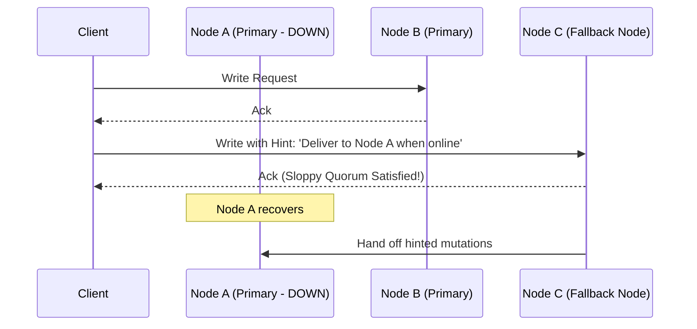

# High Availability: Sloppy Quorums and Hinted Handoff

When network partitions prevent strict quorum reads ($R + W > N$), Dynamo-style systems degrade gracefully into sloppy quorums with hinted handoffs.

---

## 1. Strict vs Sloppy Quorum
- **Strict Quorum:** $R + W > N$ over the fixed preference list. Guarantees read-your-writes consistency.
- **Sloppy Quorum:** Allows writes to healthy non-preference nodes during partition, prioritizing availability over consistency (AP in CAP).
