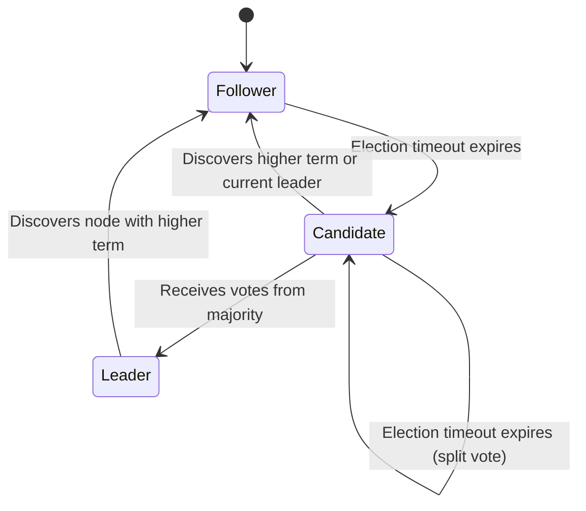
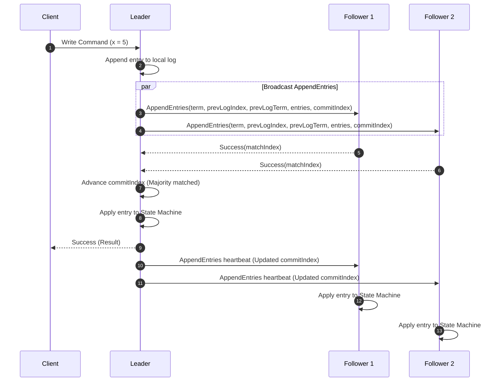

# Raft Distributed Consensus Protocol

Raft decomposes distributed consensus into three independent subproblems: leader election, log replication, and safety. A cluster of $2F + 1$ nodes tolerates up to $F$ concurrent node crash failures.

---

## 1. Node Roles and State Transitions



Every server persists state across restarts:
- `currentTerm`: Monotonically increasing counter; exchange during RPCs detects stale nodes.
- `votedFor`: Candidate ID granted vote in `currentTerm` (`null` if none).
- `log[]`: Sequential array containing state machine commands and assigned term numbers.

Volatile state on all nodes:
- `commitIndex`: Index of highest log entry known committed.
- `lastApplied`: Index of highest log entry applied to the state machine.

Volatile state on Leaders (re-initialized after election):
- `nextIndex[]`: Index of the next log entry to send to each server (initialized to `lastLogIndex + 1`).
- `matchIndex[]`: Index of highest log entry known replicated on each server (initialized to 0).

---

## 2. Leader Election Algorithm

1. **Heartbeat & Inactivity Tracking**: Followers expect periodic `AppendEntries` heartbeats (typical interval $50\text{ms}$).
2. **Randomized Election Timeouts**: Inactivity timeout chosen uniformly from $[150\text{ms}, 300\text{ms}]$ breaks election ties.
3. **Triggering Election**:
   - Increment `currentTerm`.
   - Transition to `Candidate`.
   - Vote for self (`votedFor = self`).
   - Reset election timer.
   - Send `RequestVote(term, candidateId, lastLogIndex, lastLogTerm)` to all peers concurrently.
4. **Election Outcomes**:
   - **Majority Vote**: Secures votes from $\lfloor N/2 \rfloor + 1$ servers $\rightarrow$ transitions to Leader, immediately sends empty `AppendEntries` heartbeats to suppress competing candidates.
   - **Leader Discovery**: Receives `AppendEntries` from server claiming term $T \ge \text{currentTerm} \rightarrow$ recognizes valid leader, reverts to Follower.
   - **Split Vote / Timeout**: Election timer expires without majority $\rightarrow$ starts new election with incremented term.

---

## 3. Log Replication & Commit Guarantees



### Log Matching Property
- If two entries in different logs have the same index and term, they store the same command.
- If two entries in different logs have the same index and term, their logs are identical in all preceding entries.

### AppendEntries Consistency Check
1. Leader includes `prevLogIndex` and `prevLogTerm` preceding new entries.
2. Follower verifies its local log at `prevLogIndex` matches `prevLogTerm`.
3. If mismatch occurs, follower rejects RPC. Leader decrements `nextIndex` for that follower and retries until log convergence point is reached.

---

## 4. Fundamental Safety Invariants

| Safety Invariant | Definition |
|---|---|
| **Election Safety** | At most one leader can be elected in a given term. |
| **Leader Append-Only** | A leader never overwrites or truncates its own log entries; it only appends new entries. |
| **Log Matching** | If a log entry is present at index $i$ and term $t$ across two servers, all entries from $1$ to $i-1$ match identically. |
| **Leader Completeness** | If a log entry is committed in a given term, that entry will be present in the logs of the leaders for all higher-numbered terms. |
| **State Machine Safety** | If a server applies an entry at index $i$ to its state machine, no other server will ever apply a different log entry for index $i$. |

---

## 5. Election Restriction (Leader Completeness Proof)

Voter rejects `RequestVote` if candidate's log is less up-to-date than voter's log:
```
Candidate Log (cTerm, cIndex) >= Voter Log (vTerm, vIndex) IF:
  cTerm > vTerm OR (cTerm == vTerm AND cIndex >= vIndex)
```

Because an entry requires confirmation from a majority before commit, any newly elected leader must intersect with that majority quorum, guaranteeing it contains all previously committed entries.

---

## 6. Cluster Membership Changes & Log Compaction

### Joint Consensus ($C_{\text{old}, \text{new}}$)
Configuration transitions cannot happen instantaneously across all nodes. Raft uses two-phase joint consensus:
1. Leader enters joint configuration $C_{\text{old}, \text{new}}$: entries require separate majorities from both $C_{\text{old}}$ and $C_{\text{new}}$ to commit.
2. Once $C_{\text{old}, \text{new}}$ commits, leader writes and commits final configuration $C_{\text{new}}$.

### Snapshotting (`InstallSnapshot` RPC)
To prevent logs from growing unbounded:
- Server periodically writes state machine state to immutable disk snapshot.
- Discards all log entries up to `lastIncludedIndex`.
- Slow or partitioned followers receive entire snapshot via `InstallSnapshot` rather than missing log streams.
