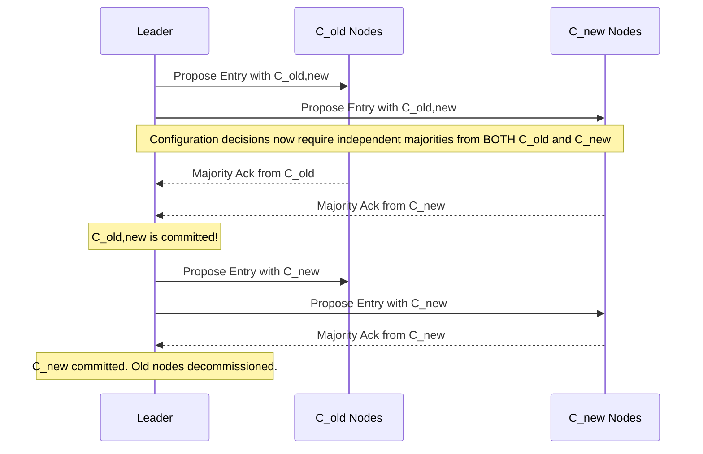

# Raft Consensus: Joint Consensus Dynamic Membership Changes

Raft's joint consensus configuration transition allows a cluster to transition between two distinct membership configurations (`C_old` and `C_new`) without any period where split-brain or two independent quorums can form.

---

## 1. Safety Invariants
1. **No Disjoint Majorities:** Any majority of `C_old` intersects with any other majority of `C_old`. Similarly, any majority of `C_new` intersects with any majority of `C_new`.
2. **Immediate Effect:** Each node begins using the new configuration as soon as it appends the entry to its local log, regardless of whether it is committed yet.
3. **Commit Rule:** A log entry under joint consensus requires independent majorities from both `C_old` and `C_new` before being marked committed.
