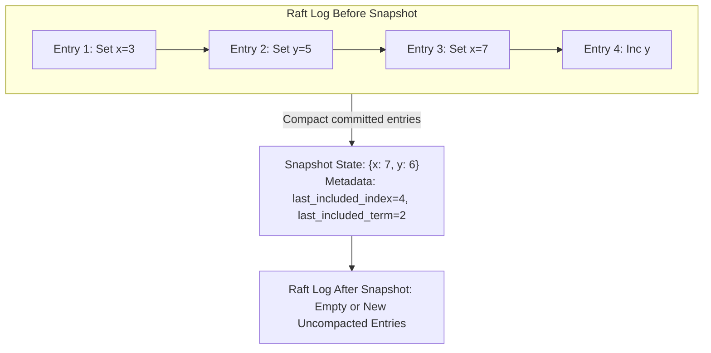

# Raft Log Compaction & Snapshotting Architecture

In consensus protocols like Raft, an unbounded log consumes excessive memory and prolongs node recovery. Snapshotting compacts committed state by writing state machine snapshots to disk and discarding preceding log entries.

---

## 1. Core Mechanics

1. **Snapshot Creation:** The application state machine serializes its current state to persistent storage. Once confirmed, Raft updates `last_included_index` and `last_included_term`.
2. **Log Truncation:** Log entries up to `last_included_index` are deleted. The prefix is discarded while preserving metadata for subsequent AppendEntries RPC validations.
3. **Slow Follower Catch-up:** If a lagging follower requires an entry that the leader has discarded, the leader issues an `InstallSnapshot` RPC instead of `AppendEntries`.
