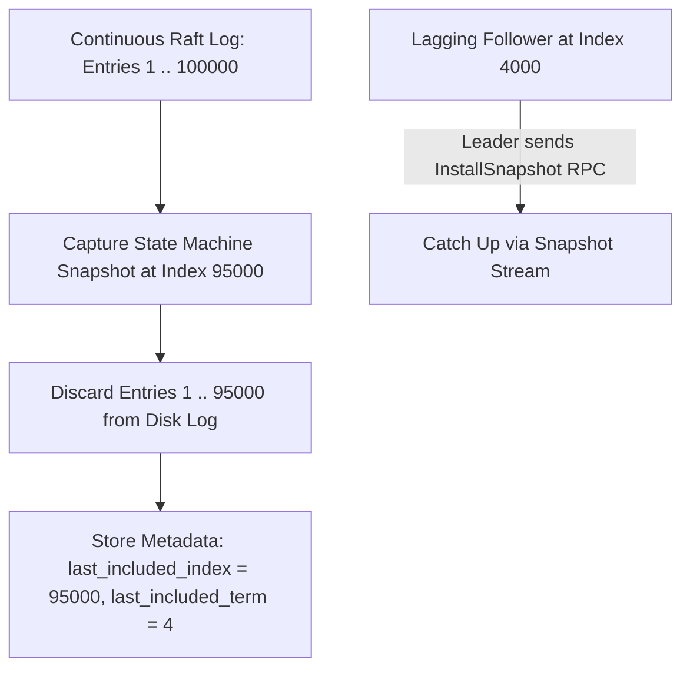

# Raft Consensus: Log Compaction & Snapshotting Architecture

Raft prevents write logs from growing unbounded by periodically capturing state machine snapshots, discarding preceding log entries and streaming snapshot chunks to catch up lagging followers.

---

## 1. InstallSnapshot RPC Invariant

When leader discovers a follower's `nextIndex` precedes the leader's oldest retained log entry, it bypasses `AppendEntries` and transmits the snapshot image directly using `InstallSnapshot`.
