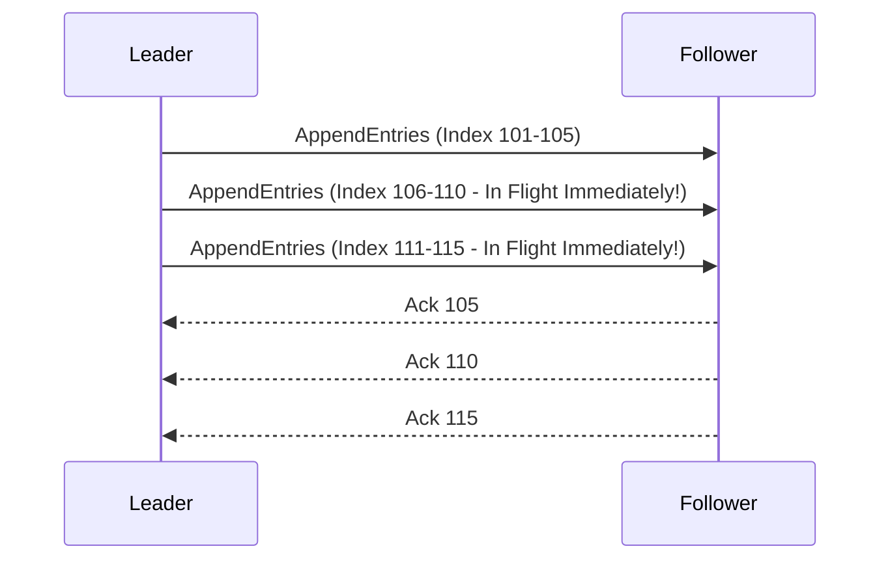

# High-Performance Raft: Pipelined AppendEntries and Batching

Vanilla Raft waits for an AppendEntries response before sending subsequent entries. Pipelining decouples throughput from round-trip network latency.

---

## 1. In-Flight Window Control
- Leaders track maximum in-flight bytes or message counts.
- If a follower drops packets or rejects an append due to log divergence, the pipeline resets back to the follower's confirmed `matchIndex`.
