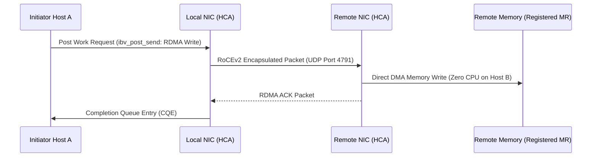

# RDMA & RoCEv2 Architecture for Ultra-Low Latency

Remote Direct Memory Access (RDMA) allows network interface cards to read and write remote host memory directly without invoking remote CPU cycles.



---

## 1. RDMA Operation Comparison

| RDMA Verb | Type | Remote CPU Involvement | Use Case in Trading Systems |
|---|---|---|---|
| `ibv_post_send` (RDMA Write) | One-sided | 0% (DMA directly to remote address) | Market data dissemination |
| `ibv_post_send` (RDMA Read) | One-sided | 0% (Remote NIC reads RAM directly) | Order state snapshot retrieval |
| `ibv_post_send` (Send/Receive) | Two-sided | Remote CPU must post matching receive buffer | Order entry / execution confirmation |
| `ibv_post_send` (Atomic CAS) | One-sided | 0% (NIC executes hardware 64-bit CAS) | Distributed sequence number assignment |

---

## 2. Memory Registration (ibv_reg_mr)

Memory regions must be registered with the Host Channel Adapter (HCA) to prevent OS swapping and translate virtual to physical addresses in hardware:

```c
#include <infiniband/verbs.h>

struct ibv_mr *register_trading_buffer(struct ibv_pd *pd, void *addr, size_t length) {
    int flags = IBV_ACCESS_LOCAL_WRITE |
                IBV_ACCESS_REMOTE_WRITE |
                IBV_ACCESS_REMOTE_READ;

    // Pin memory pages into RAM and load translation table into NIC hardware
    struct ibv_mr *mr = ibv_reg_mr(pd, addr, length, flags);
    return mr;
}
```
