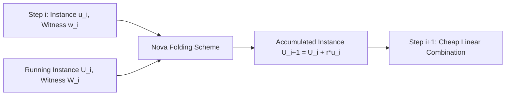

# Recursive SNARKs & Nova Incrementally Verifiable Computation

Nova replaces expensive SNARK-inside-SNARK proof verification with non-interactive folding schemes over cycles of elliptic curves, accumulating computations at near-constant verification cost.

---

## 1. Classical Recursion vs Nova Folding

| Feature | Classical Recursive SNARKs (Groth16/Plonk) | Nova Folding Scheme |
|---|---|---|
| **Step Overhead** | Full SNARK verification circuit per step ($10^5 - 10^6$ constraints). | Single multi-exponentiation check ($pprox 2 	imes 10^3$ constraints). |
| **Curve Requirements** | Pairing-friendly cycles (MNT4/MNT6 or Pasta curves). | Standard elliptic curve cycles (Pasta curves: Pallas & Vesta). |
| **Proof Deferral** | Generates full proof at each intermediate step. | Accumulates witness; generates **single** final SNARK at completion. |
| **Ideal Workloads** | Stateless blockchain validity proofs. | Long sequential VM execution traces, verifiable delay functions. |
