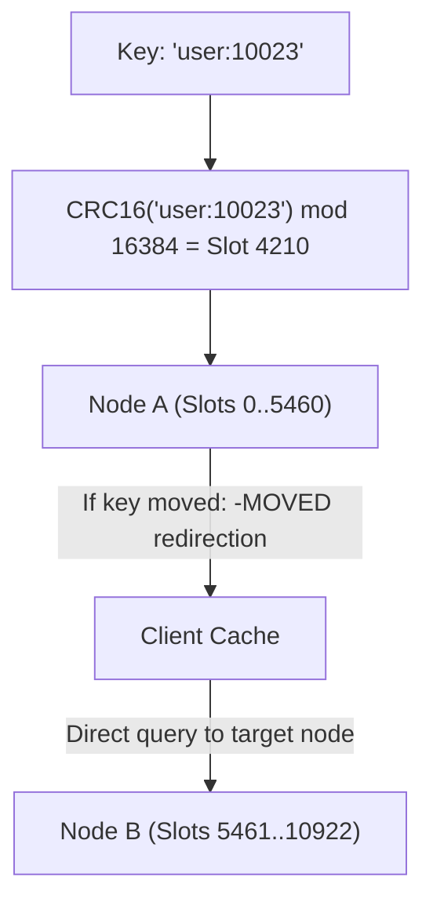

# Redis Cluster: 16384 Hash Slots & Gossip Protocol

Redis Cluster shards data horizontally across autonomous nodes using fixed hash slots and manages cluster state using an asynchronous gossip protocol.

---

## 1. Protocol Architecture

* **Hash Tags:** Substrings wrapped in `{...}` force specific keys to the same slot (e.g., `{user:123}:orders` and `{user:123}:profile`), enabling multi-key transactions.
* **Gossip Frames:** Nodes exchange PING/PONG heartbeat packets over cluster bus ports, broadcasting slot state changes, replica failovers, and node failure detection (`PFIL` / `FAIL`).
