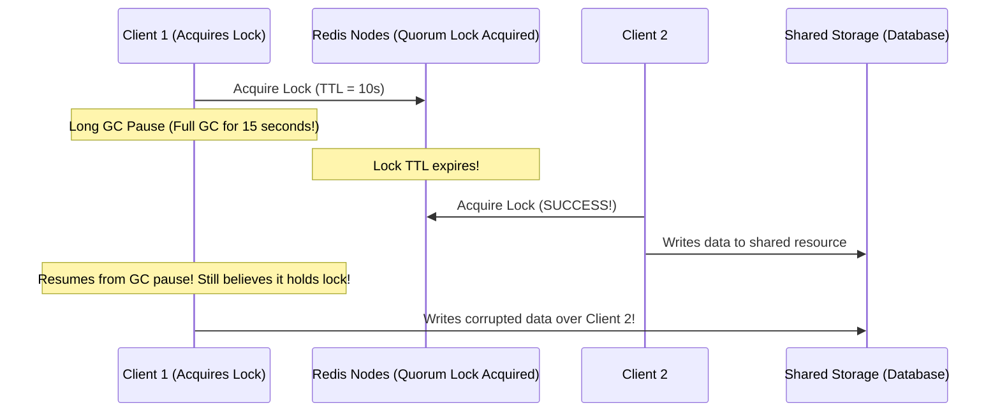

# Distributed Consensus: The Redlock Algorithm and Martin Kleppmann's Critique

Redlock attempts distributed mutual exclusion using multiple independent Redis nodes without consensus protocols, but fails under asynchronous network pauses.

---

## 1. Proper Solution: Fencing Tokens
Every lock acquisition must return a monotonically increasing fencing token. The storage engine rejects any write carrying a fencing token lower than the highest token observed.
