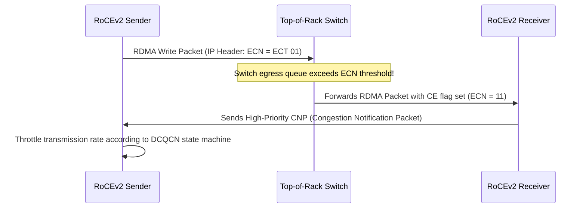

# RoCEv2 ECN & Congestion Notification Packets (CNP) Architecture

RDMA over Converged Ethernet v2 uses Explicit Congestion Notification (ECN) and Congestion Notification Packets (CNP) to eliminate packet loss and buffer overflow without relying solely on coarse Priority Flow Control (PFC) pause frames.

---

## 1. DCQCN Algorithm

* **Rate Reduction:** When sender receives CNP, target rate $R_T$ updates:
  $$R_T = R_C, \quad R_C = R_C \cdot (1 - lpha / 2)$$
* **Rate Recovery:** Sender recovers rate periodically via additive increase timers when no CNPs arrive.
