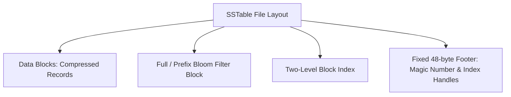

# LSM Internals: RocksDB Block-Based SSTable and Prefix Bloom Filters

RocksDB SSTables divide keys into fixed-size data blocks (typically 4KB), indexed by a two-level Block Index and filtered via Bloom filters.

---

## 1. Prefix Bloom Filters
For range scans like `Seek("user_102:timestamp_09")`:
- A prefix extractor chops the key to `"user_102"`.
- The prefix filter verifies whether any keys with that prefix exist in the SSTable, skipping the entire file if negative.
