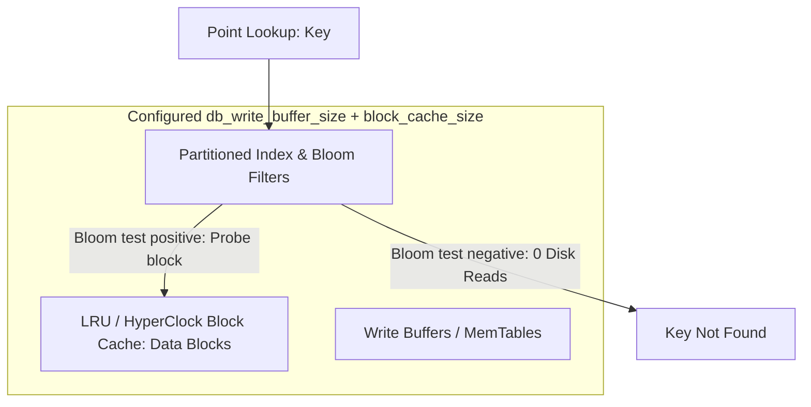

# RocksDB: Block Cache & Bloom Filter Optimization

RocksDB performance hinges on tuning memory allocations between the uncompressed Block Cache, index/filter partitions, and write buffer MemTables.

---

## 1. High-Performance Configuration

1. **Partitioned Filters:** Set `cache_index_and_filter_blocks = true` and `partition_filters = true` to avoid loading multi-gigabyte SSTable filter indexes in a single allocation.
2. **Full Filter vs Block-based:** Use Ribbon filters or Full Filters (`bits_per_key = 10`) for 1% false positive rates with reduced memory footprints.
3. **HyperClockCache:** Replaces standard mutex-locked LRU caches with lock-free CLOCK eviction algorithms, scaling to dozens of concurrent query threads.
