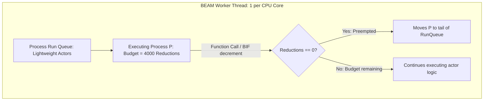

# Runtime Systems: Erlang BEAM Actor Scheduling & Isolated Heaps

The Erlang/Elixir BEAM virtual machine schedules lightweight actor processes using reduction counters, enforcing deterministic preemption and eliminating stop-the-world global garbage collection pauses.

---

## 1. Architectural Invariants

* **Isolated Heaps:** Every process possesses a private heap; garbage collection executes independently per actor without stopping other processes.
* **Reduction Budget:** A reduction represents work done (one function call or built-in function execution). After 4,000 reductions, the process is preempted regardless of code structure, preventing CPU-bound actors from starving others.
* **Zero-Lock Message Passing:** Messages are copied from sender heap to recipient mailbox buffer; large binaries ($> 64	ext{ bytes}$) use a global reference-counted binary heap to avoid deep copying.
