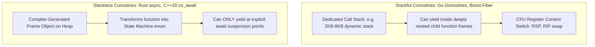

# Runtime Systems: Stackful Fibers vs Stackless Coroutines

Concurrency runtimes organize cooperative multitasking using either stackful coroutines (independent dynamic stacks) or stackless coroutines (compiler-generated state machines).

---

## 1. Architectural Comparison

| Attribute | Stackful Coroutines | Stackless Coroutines |
|---|---|---|
| **Memory Overhead** | Higher (2KB to 8KB stack per fiber) | Minimal (Bytes needed for live variables) |
| **Yield Capability** | Arbitrary nested depth within call stack | Only at designated suspension points (`await`) |
| **FFI Compatibility** | Direct invocation of standard C functions | Requires bridging or offloading to thread pools |
| **Context Switch** | Saves and restores CPU register context | Updates state enum and returns to event loop |
