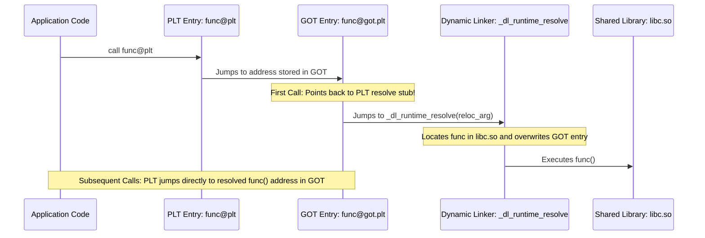

# Executable Binaries: ELF Dynamic Linking with GOT & PLT

Dynamic linkers (`ld.so`) resolve external library symbol references in Position-Independent Executables (PIE) using the Procedure Linkage Table (PLT) and Global Offset Table (GOT).

---

## 1. Security & Relocations

* **Lazy Binding:** By default, symbol resolution is deferred until the first function call occurs.
* **Full RELRO (`-Wl,-z,relro,-z,now`):**
  - Resolves all dynamic symbols during binary load time (`DT_BIND_NOW`).
  - Marks the `.got` memory page strictly read-only (`mprotect(PROT_READ)`), preventing attackers from hijacking function pointers via GOT-overwrite exploits.
