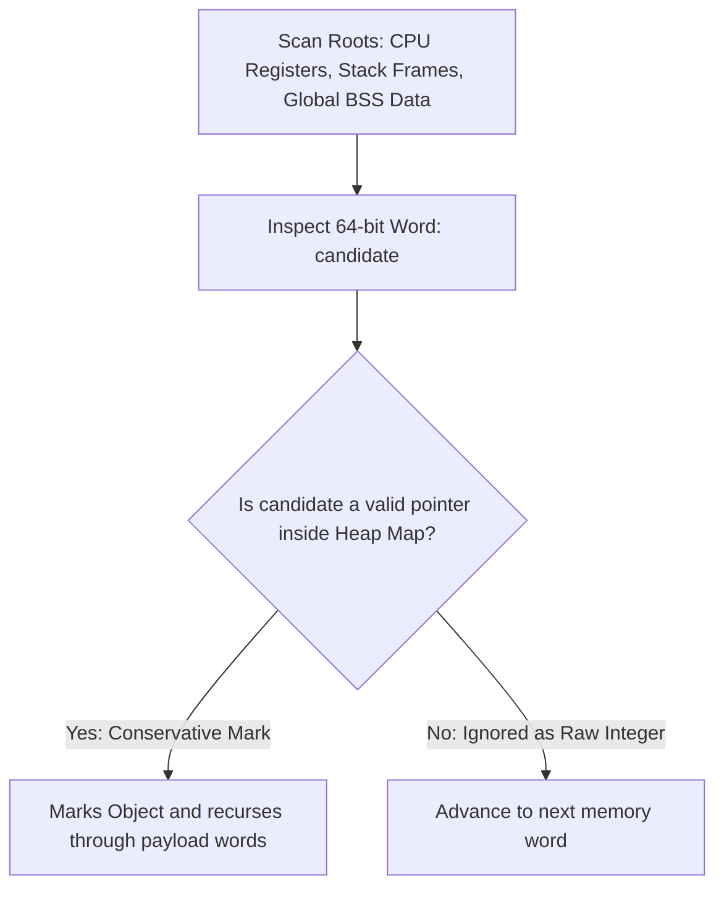

# Memory Management: Boehm-Demers-Weiser Conservative Garbage Collector

The Boehm GC provides automatic garbage collection for uncooperative languages (C/C++) by treating any integer in memory or CPU registers that matches a valid heap address as a potential pointer.

---

## 1. Key Invariants & Trade-offs

* **Conservative Pointer Identification:** Because C compilers do not emit type descriptors (stack maps), the collector assumes any aligned word within $[heap\_start, heap\_end]$ pointing to an allocated chunk is a pointer.
* **No Object Relocation:** Because it cannot differentiate raw integers from pointers, Boehm GC cannot rewrite references; objects can never be moved or compacted.
* **Blacklisting:** Pages with high frequencies of false-positive pointer candidates are blacklisted from small object allocations to prevent memory leaks.
