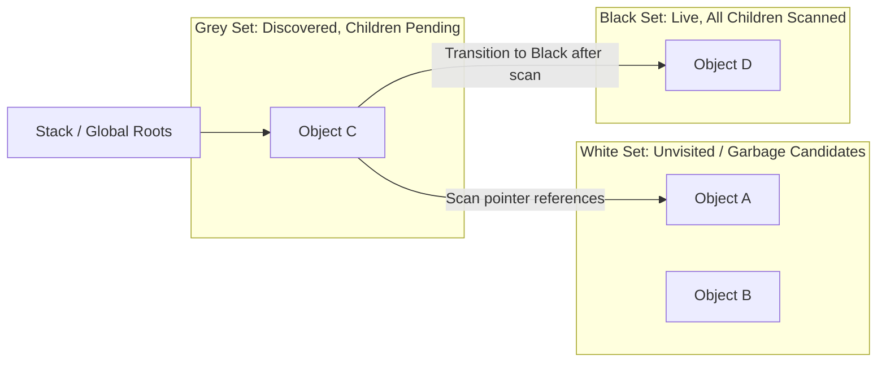

# Runtime Systems: Go Tri-Color Concurrent Mark-Sweep Collector

The Go runtime executes concurrent garbage collection using a tri-color abstraction combined with a hybrid write barrier that balances collector efficiency and mutator latency.



---

## 1. Tri-Color Invariants & Hybrid Write Barrier

1. **Strong Tri-Color Invariant:** Black objects cannot hold pointers directly to White objects unless mediated by a Grey object.
2. **Go Hybrid Write Barrier (Dijkstra + Yuasa):**
   ```go
   // Triggered whenever a pointer field is overwritten: *slot = ptr
   func writeBarrier(slot *unsafe.Pointer, ptr unsafe.Pointer) {
       shade(*slot) // Shades old pointer value (Yuasa deletion barrier)
       shade(ptr)   // Shades new pointer value (Dijkstra insertion barrier)
   }
   ```
3. **Zero Stack Rescanning:** Shading both old and new targets allows Go goroutine stacks to remain completely unwatched without requiring a stop-the-world stack rescan pass.
