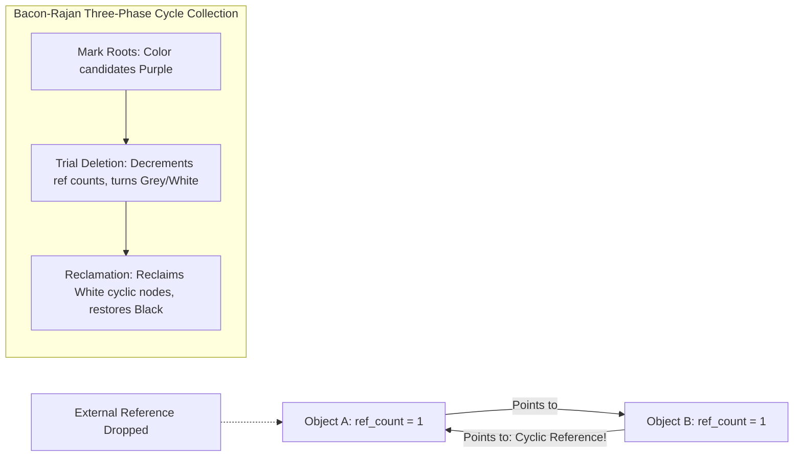

# Memory Management: Reference Counting & Cycle Collection (Bacon-Rajan)

Automatic Reference Counting (ARC) reclaims objects deterministically upon pointer discard, using Bacon-Rajan cycle collection algorithms to detect and reclaim cyclic reference graphs.

---

## 1. Node Color States

* **Black:** In use or already freed; not part of any suspected garbage cycle.
* **Grey:** Visited during trial deletion; reference counts decremented to identify internal cycles.
* **White:** Confirmed cyclic garbage; marked for memory deallocation.
* **Purple:** Possible root of a cycle (flagged when a reference count drops without hitting zero).
* **Trial Deletion:** If decrementing internal pointer counts within a subgraph brings all subgraph reference counts to zero, the entire cluster represents an isolated cyclic garbage island.
