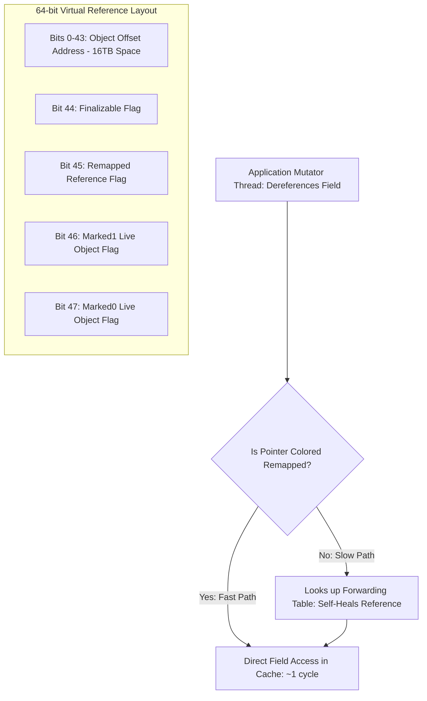

# Runtime Systems: OpenJDK ZGC Colored Pointers & Load Barriers

The OpenJDK Z Garbage Collector (ZGC) achieves sub-millisecond maximum pause times across terabyte-scale heaps using 64-bit reference colored pointers and concurrent JIT load barriers.

---

## 1. Operating Mechanics

* **Colored Pointers:** Metadata bits reside inside reference pointer words rather than object headers, allowing ZGC to inspect object liveness without dereferencing heap memory.
* **Self-Healing Load Barrier:** When a thread loads a reference pointing to an object relocated during concurrent evacuation, the load barrier intercepts the read, updates the pointer in place to the new forwarding address, and completes the read without blocking other threads.
* **Address Space Aliasing:** Uses page table aliasing on Linux (`memfd_create`) to map `Marked0`, `Marked1`, and `Remapped` address spaces to identical physical memory frames.
