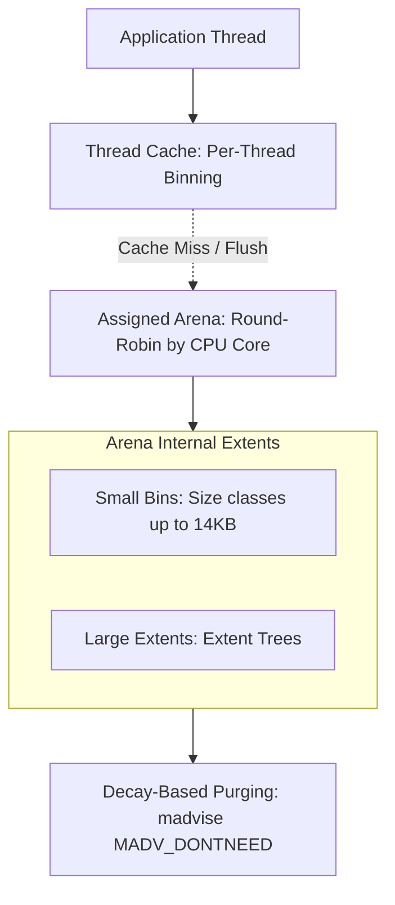

# Memory Allocation: jemalloc Arena Architecture & Decay Purging

The `jemalloc` memory allocator eliminates lock contention on multi-core servers by partitioning memory management across independent Arenas, thread caches, and decay-based physical page purging.

---

## 1. Architectural Highlights

* **Arenas Partitioning:** `jemalloc` instantiates $4 	imes N_{	ext{cores}}$ independent arenas. Threads hash to arenas, eliminating global heap lock contention.
* **Size Class Categories:**
  - **Small:** Quantum-spaced bins ($8, 16, 32, \dots$ bytes).
  - **Large:** Multiple of page sizes ($4	ext{KB}, 8	ext{KB}, \dots$).
* **Decay Purging:** Uses exponential decay curves (`dirty_decay_ms`) to return unused physical pages to the operating system via `madvise(MADV_DONTNEED)` without fragmenting virtual address spaces.
