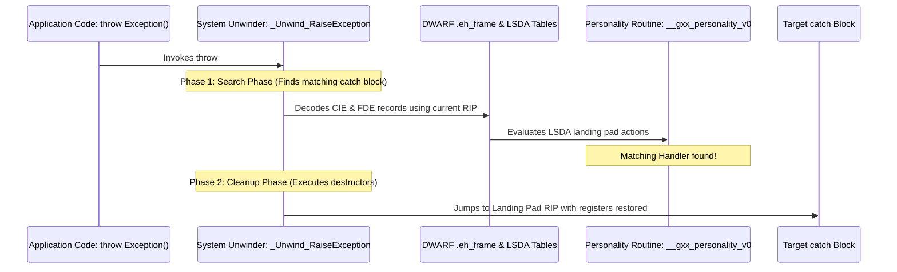

# Executable Binaries: DWARF .eh_frame Zero-Cost Exception Handling

Zero-cost exception handling incurs zero CPU overhead during normal execution paths by encoding stack unwinding metadata into read-only DWARF `.eh_frame` tables evaluated only when an exception is thrown.

---

## 1. Data Structures

* **CIE (Common Information Entry):** Defines architecture calling conventions, code alignment factors, and return address register ID.
* **FDE (Frame Description Entry):** Encodes table transitions that map instruction address ranges (`PC`) to Canonical Frame Address (CFA) offset rules.
* **LSDA (Language Specific Data Area):** Encodes language-specific exception tables, type filters, and landing pad addresses.
