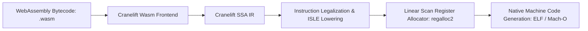

# WebAssembly: Cranelift Code Generator & AOT Compilation

Cranelift translates WebAssembly bytecode into machine code via an SSA intermediate representation designed for compilation speed, verified safety, and predictable execution latencies.

---

## 1. Cranelift Architecture Highlights

1. **SSA Verification:** Cranelift validates that all variables obey Single Static Assignment dominance rules before optimization passes run.
2. **ISLE (Instruction Selection Lowering Engine):** Domain-specific pattern-matching language that specifies machine instruction lowerings with provable correctness.
3. **Linear Scan Register Allocator (`regalloc2`):** Optimized for low compile-time overhead; computes liveranges and assigns registers in linear time without expensive graph coloring passes.
