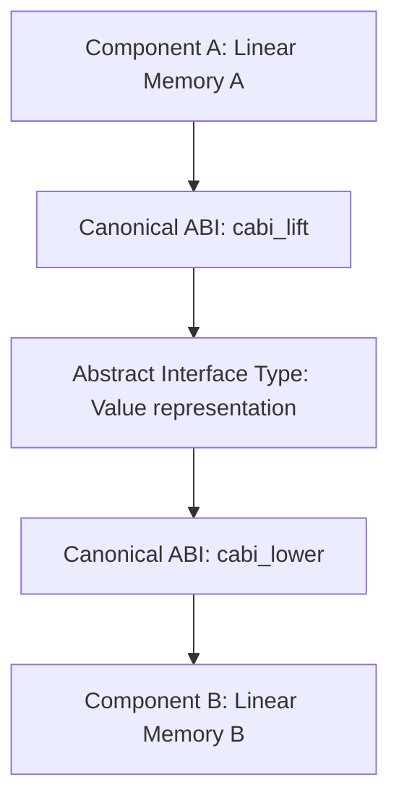

# WebAssembly: Component Model & Canonical ABI Layout

The WebAssembly Component Model defines the Canonical ABI to lift and lower complex data types (strings, variants, records, lists) across isolated WebAssembly component memory boundaries.

---

## 1. Canonical Lowering & Lifting Rules

* **String Representation:** Lowered into a 2-word pointer and byte length pair `(ptr, len)` in linear memory; UTF-8 validation occurs during crossing.
* **Variant & Union Layout:** Lowered into a discriminant integer tag followed by a payload union sized to the largest variant member.
* **Realloc Allocator Hook:** Crossing components allocate target memory dynamically via the guest's exported `cabi_realloc(orig_ptr, orig_size, alignment, new_size)` hook, guaranteeing sound memory boundaries.
