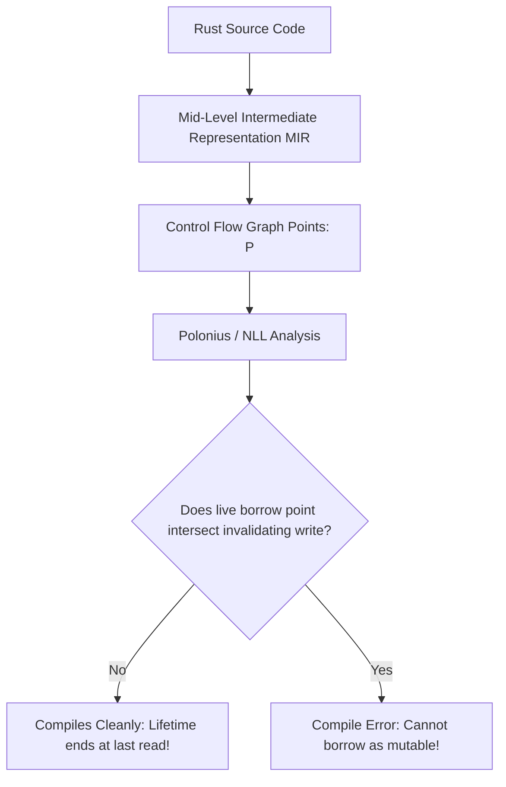

# Rust Internals: Non-Lexical Lifetimes (NLL) Borrow Checker

Early Rust enforced lexical lifetimes tied to lexical code blocks `{}`. Non-Lexical Lifetimes (NLL) and the Polonius borrow checker track origins and liveness on the Control Flow Graph (CFG).

---

## 1. Ergonomic Impact
Allows mutable borrows to end immediately after their last operational read or write statement without requiring unnatural nested braces.
