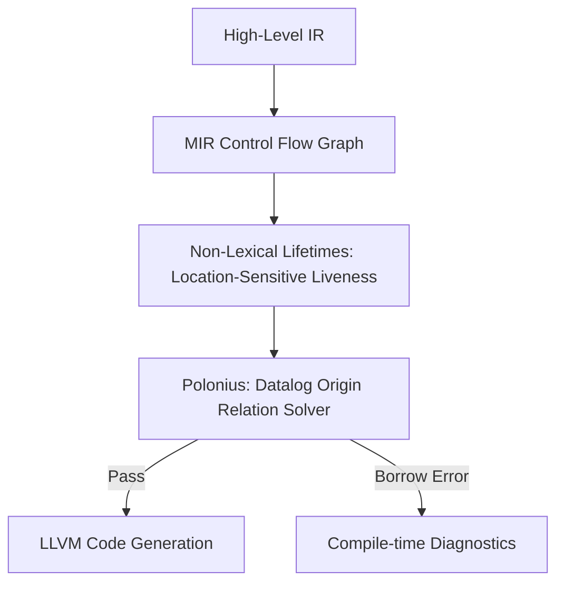

# Rust MIR Borrow Checking & Polonius Origin Analysis

Rust verifies memory safety at the Mid-level Intermediate Representation (MIR) layer by computing loan liveness across control flow graphs without runtime overhead.

---

## 1. Fundamental Relations in Polonius

$$	ext{origin\_contains\_loan}(O, L) \impliedby 	ext{loan\_issued\_at}(O, L, P)$$
$$	ext{loan\_live\_at}(L, P) \impliedby 	ext{origin\_contains\_loan}(O, L) \land 	ext{origin\_live\_on\_entry}(O, P)$$
