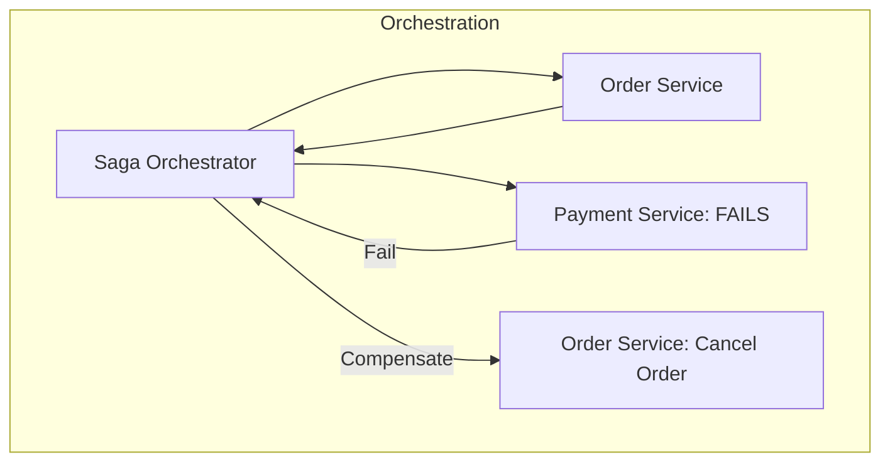

# Microservices: Saga Pattern Orchestration vs Choreography

A Saga is a sequence of local transactions where each step updates a service database and publishes an event; if a step fails, compensating transactions undo preceding changes.

---

## 1. Comparison Matrix

| Dimension | Orchestration | Choreography |
| :--- | :--- | :--- |
| **Control** | Centralized orchestrator state machine | Decentralized event pub/sub |
| **Coupling** | Services know only orchestrator | Services must know downstream events |
| **Debugging** | Clear audit trace in orchestrator | Distributed tracing required across queues |
