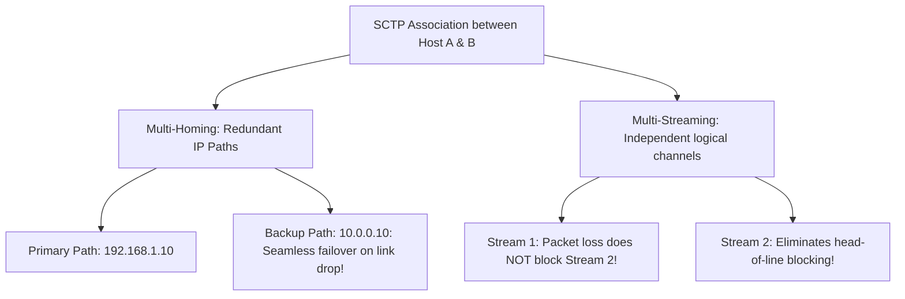

# Transport Protocols: SCTP Multi-Homing and Multi-Streaming

Stream Control Transmission Protocol (SCTP, RFC 4960) provides message-oriented, multi-homed, and multi-stream transport, powering telecom 5G signaling and WebRTC data channels.

---

## 1. 4-Way Cookie Handshake
SCTP uses an `INIT / INIT-ACK / COOKIE-ECHO / COOKIE-ACK` handshake to prevent SYN flood attacks by making the handshake state-free until the third flight.
