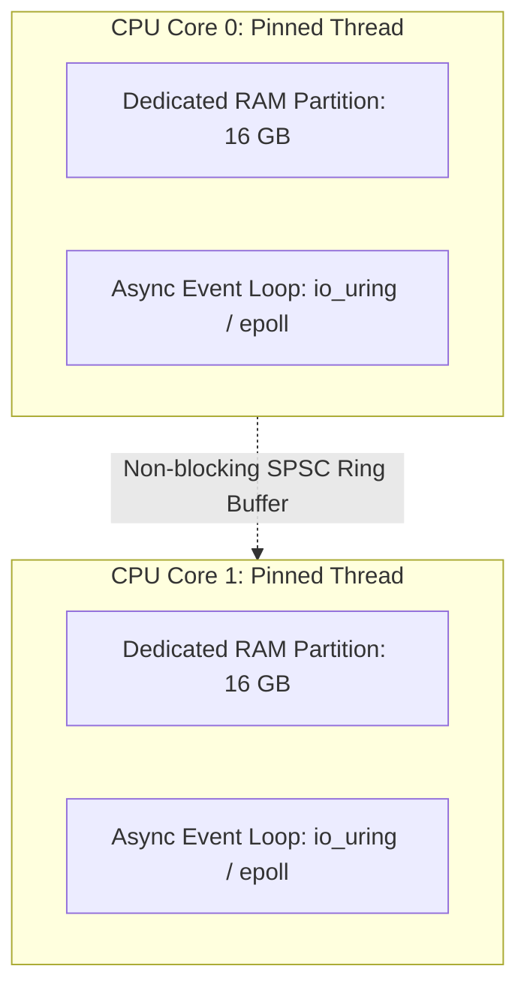

# ScyllaDB: Thread-per-Core Architecture & Seastar Engine

ScyllaDB replaces JVM garbage collection and thread synchronization with the Seastar C++ framework, employing a shared-nothing, thread-per-core asynchronous model.

---

## 1. Design Principles

1. **Core Isolation:** Each OS thread pins to a dedicated CPU core with its own memory partition, avoiding cross-core cache invalidation.
2. **Lockless Communication:** Inter-thread communication uses Single-Producer Single-Consumer (SPSC) ring queues instead of mutexes.
3. **Autonomous I/O Scheduler:** An integrated I/O scheduler prioritizes user reads over background SSTable compaction to guarantee sub-millisecond p99 latencies.
