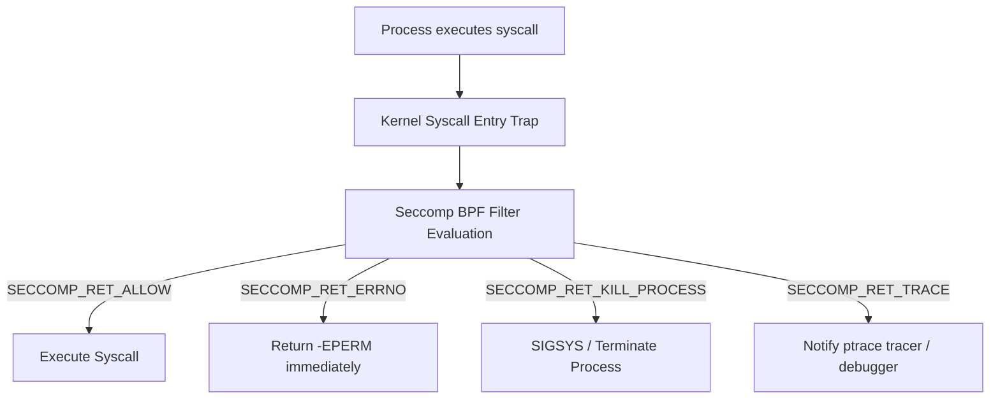

# Seccomp-BPF System Call Sandbox Filtering

Secure Computing Mode with BPF filters inspects system call numbers and register arguments before permitting user-space processes to enter the kernel, neutralizing entire classes of privilege escalation attacks.

---

## 1. Filter Return Codes

| Action | Function |
|---|---|
| `SECCOMP_RET_ALLOW` | Permits system call execution without intervention. |
| `SECCOMP_RET_ERRNO` | Halts system call and simulates kernel error return (e.g. `EACCES`, `ENOSYS`). |
| `SECCOMP_RET_KILL_PROCESS` | Instantly destroys entire thread group. |
| `SECCOMP_RET_TRAP` | Emits `SIGSYS` signal with `siginfo_t` containing syscall architecture and registers. |
