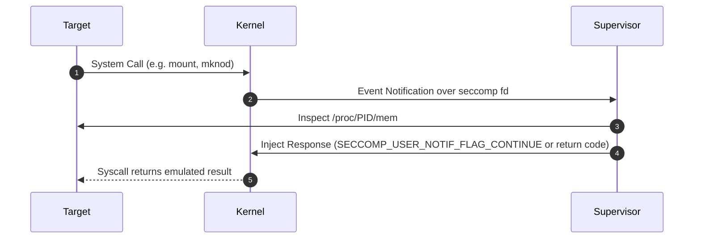

# Linux seccomp User Notification Filters

`SECCOMP_RET_USER_NOTIF` allows an unprivileged process's system call to be intercepted and emulated by an unprivileged supervisor process.

---

## 1. Core Workflow

1. Target process installs BPF filter returning `SECCOMP_RET_USER_NOTIF` and obtains a listener file descriptor.
2. Supervisor receives notification struct containing syscall arguments and PID.
3. Supervisor performs action and issues `ioctl(SECCOMP_IOCTL_NOTIF_SEND)`.
